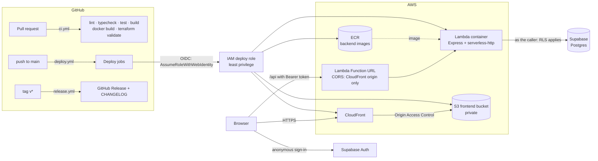

# Half Full

> A personal, minimalist life tracker. Every goal is a glass that fills: tick a habit, log a
> measurement or finish a session, and the water rises. Nothing ever tells you that you are behind.

The product is called **Half Full**; the repository, the npm packages and every storage key stay
`progress-tracker` (renaming the repository would break the deploy role's OIDC trust policy, and
renaming a storage key would sign every visitor out). [`CLAUDE.md`](CLAUDE.md) is the detailed
project context — product rules, contracts and the lessons behind them — and wins over this file
wherever the two disagree.

## Status

**`0.4.1-alpha` is live.** Merging to `main` deploys automatically, and the deploy fails unless the
live `GET /health` reports the commit that was pushed.

What a visitor can do today:

- **Start without signing up.** A front door explains the app; pressing its button creates an
  anonymous account (a real Supabase user, no password). Its goals live for **90 days from the last
  visit**. There is no sign-in, permanent account or export yet.
- **Build a board.** Add goals from a catalogue of six per life area, or write your own. Goals are
  `habit` (a target and a gentler minimum per period), `measured` (a value toward a target) or
  `scheduled` (sessions). Six fixed life areas; colour always means area and is always named in text.
- **Fill the glasses.** Tick a goal done, log a value, undo either in one tap. A goal's size on the
  board is how important it is, and the board can be rearranged by drag or entirely by keyboard.
- **Plan days.** Repeat rules put goals on a calendar; a single day can be taken off it. Editing a
  rule never rewrites days already lived.
- **Four pages:** the board, the calendar, "My full glasses" (finished goals — a shelf, not a trophy
  cabinet) and a profile with plain facts, time zone and week start.

**In progress on `feat/glass-water`, for the next minor release:** every tile becomes a glass
standing on a shelf with its words underneath — nothing is written on the water any more — and the
water is replaced by a sloshing model that breaks into droplets on violent moments, pours when a
goal is ticked and settles to stillness.

Not built yet: Google/Apple Calendar sync, reminders and notifications, permanent accounts.

## Architecture



| Piece          | Where                 | Notes                                                                                                                                                                      |
| -------------- | --------------------- | -------------------------------------------------------------------------------------------------------------------------------------------------------------------------- |
| Frontend       | `frontend/`           | React + Vite + TypeScript. Static build → private S3 bucket, served only through CloudFront (OAC).                                                                         |
| Backend        | `backend/`            | Express + TypeScript. `src/app.ts` is shared; `src/server.ts` runs it locally, `src/lambda.ts` on Lambda.                                                                  |
| Database, auth | Supabase, `supabase/` | Postgres with row-level security, anonymous auth. Schema notes and how migrations are applied: [`supabase/README.md`](supabase/README.md).                                 |
| API endpoint   | Lambda Function URL   | Every `/api` route needs the caller's Supabase token and runs **as that user**, so RLS — not route code — keeps one account's goals from another. `/health*` is anonymous. |
| Remote state   | `infra/bootstrap/`    | S3 state bucket + DynamoDB lock table. Applied once, with local state.                                                                                                     |
| Infrastructure | `infra/main/`         | ECR, Lambda, Function URL, S3 + CloudFront, GitHub OIDC provider + deploy role.                                                                                            |
| CI/CD auth     | GitHub OIDC → IAM     | No long-lived AWS keys exist anywhere. The role trusts only `main` of this repository.                                                                                     |

Limits that protect an open API live in the database (caps on goals, entries and text length;
a shared per-session request counter), so a forgotten check in a route cannot bypass them.

## Local development

**Prerequisites:** Node.js 22 (`nvm use` reads `.nvmrc`), npm 10+. Docker only to test the Lambda
image locally.

```bash
npm run setup                                # installs root, frontend/ and backend/ dependencies
cp backend/.env.example backend/.env         # SUPABASE_URL, SUPABASE_ANON_KEY, SUPABASE_SERVICE_ROLE_KEY
cp frontend/.env.example frontend/.env       # VITE_SUPABASE_URL, VITE_SUPABASE_ANON_KEY
npm run dev                                  # backend on :3001 + frontend on :5173
```

Open <http://localhost:5173>. Vite proxies `/health` and `/api` to the local backend, so the browser
sees one origin and no CORS is involved. Using the app needs a Supabase project with the migrations
applied; without one, `GET /health` still passes and `GET /health/db` reports `unconfigured`.

### Pages for looking at the app (dev only, never in the production build)

jsdom has no layout, so a test suite can pass while a control overflows its column. These pages
render the real components from fixtures, with no session and no API behind them:

| Page            | What it is                                                                                                                                                                                                                     |
| --------------- | ------------------------------------------------------------------------------------------------------------------------------------------------------------------------------------------------------------------------------ |
| `/gallery.html` | Every screen state. `?only=<title>` narrows to matching cases, `?phone=1` puts each in a 390px stage, `?measure=1` adds measurements.                                                                                          |
| `/lab.html`     | The water bench: scripted gestures (pour, drag, flick, shake, yank, lift). `?strip=<gesture>` shows one gesture over time, `?board=1` steps the real board frame by frame, `?bench=100` reports the cost of a hundred glasses. |
| `/water.html`   | Four real glasses with move, pour and drain controls.                                                                                                                                                                          |

How to screenshot them headlessly from WSL is in [`CLAUDE.md`](CLAUDE.md#screens-and-looking-at-them).

### Everyday commands (from the repo root; each fans out to both packages)

| Command                | What it does                                 |
| ---------------------- | -------------------------------------------- |
| `npm run dev`          | Run backend + frontend together              |
| `npm run lint`         | ESLint, zero warnings allowed                |
| `npm run typecheck`    | `tsc` in both packages                       |
| `npm test`             | Vitest, single run                           |
| `npm run build`        | Production builds                            |
| `npm run format:check` | Prettier check (use `npm run format` to fix) |

The frontend's particle-fluid experiment in `src/lab/` was not adopted; its tests take about two
minutes and are excluded by default. `LAB_PARTICLES=1 npm test --prefix frontend` runs them.

### Testing the Lambda image locally (optional)

The production artifact is a container built from `backend/Dockerfile` on the AWS Lambda Node.js 22
base image, which includes the Runtime Interface Emulator:

```bash
cd backend
npm run docker:build          # buildx, linux/amd64, --provenance=false (same flags CI uses)
npm run docker:run            # emulator on :9000 — leave running, use a second terminal:
curl -s -X POST localhost:9000/2015-03-31/functions/function/invocations \
  -d @events/function-url-health.json
```

The response body should contain the version in `backend/package.json`. Add `--env-file .env` to
the `docker run` command to test `/health/db` against Supabase.

> **Linux/WSL:** if Docker says `permission denied ... docker.sock`, add yourself to the `docker`
> group (`sudo usermod -aG docker $USER`) and start a new shell.

## Deployment

### How it works

Every pull request into `main` runs CI (`.github/workflows/ci.yml`): both packages are
format-checked, linted, typechecked, tested and built; the backend's Lambda image is built (not
pushed); and both Terraform roots are `fmt`-checked and validated. **CI never applies Terraform.**

Every push to `main` runs `.github/workflows/deploy.yml`, which re-runs all of CI and then:

1. Authenticates to AWS with **GitHub OIDC** — a short-lived token exchanged for the IAM role in
   `infra/main/github_oidc.tf`. The role trusts only pushes to `main` of this repository.
2. Builds and pushes the backend image to ECR, tagged with the commit SHA.
3. Points the Lambda at the new image, sets its `SUPABASE_*` environment from GitHub secrets, then
   smoke-tests `GET /health` and **fails the deploy unless the live `commit` matches the pushed
   commit**.
4. Checks that the Function URL's CORS configuration covers every method and header the frontend
   sends, and sends a real preflight to confirm it — so a site that cannot call its own API is
   never published.
5. Builds the frontend against the Function URL and the public Supabase URL and anon key, uploads
   it to S3 — hashed assets first, `index.html` last, stale objects deleted only at the end — then
   invalidates CloudFront.

Deploys never run concurrently and are never cancelled midway.

**Two kinds of change reach production only by hand, and must do so before the pull request that
needs them merges:** anything under `infra/` (`terraform apply`), and Supabase migrations (see
[`supabase/README.md`](supabase/README.md#applying-the-migrations)). Neither is visible to
`GET /health`, so the deploy is otherwise the thing that finds out.

### First-time infrastructure setup

This has been done for the live stack; repeat it only for a new AWS account. Run from the repo
root, with AWS CLI v2 signed in (SSO recommended) and Docker available. It takes two passes because
a container-image Lambda cannot be created before an image exists in the repository that the same
root creates (`infra/main/lambda.tf` explains).

```bash
# 0. Remote state — once per AWS account
terraform -chdir=infra/bootstrap init
terraform -chdir=infra/bootstrap apply
terraform -chdir=infra/bootstrap output -raw backend_hcl > infra/main/backend.hcl

# 1. Main stack, pass 1: the ECR repository only
terraform -chdir=infra/main init -backend-config=backend.hcl
terraform -chdir=infra/main apply -target=aws_ecr_repository.backend

# 2. Push the bootstrap image
REGION=us-east-1
REPO="$(terraform -chdir=infra/main output -raw ecr_repository_url)"
aws ecr get-login-password --region "$REGION" | docker login --username AWS --password-stdin "${REPO%%/*}"
docker buildx build --platform linux/amd64 --provenance=false \
  --build-arg GIT_SHA=bootstrap -t "$REPO:bootstrap" --push backend

# 3. Main stack, pass 2: everything else (CloudFront takes several minutes)
terraform -chdir=infra/main apply

# 4. Verify the backend, then publish the GitHub secrets
curl -s "$(terraform -chdir=infra/main output -raw lambda_function_url)health"
terraform -chdir=infra/main output -json github_secrets \
  | jq -r 'to_entries[] | "\(.key)\t\(.value)"' \
  | while IFS=$'\t' read -r name value; do gh secret set "$name" --body "$value"; done
```

Keep `infra/bootstrap/terraform.tfstate` safe — it is gitignored and stays on your machine.
Losing it deletes nothing; the resources can be re-imported.

### Required GitHub secrets

All nine must exist, or the deploy fails at role assumption. The AWS account ID is deliberately
**not** stored — it is derived at runtime.

| Secret                                                                                                                         | Where it comes from                                                      |
| ------------------------------------------------------------------------------------------------------------------------------ | ------------------------------------------------------------------------ |
| `AWS_REGION`, `AWS_ROLE_ARN`, `ECR_REPOSITORY_URI`, `LAMBDA_FUNCTION_NAME`, `S3_FRONTEND_BUCKET`, `CLOUDFRONT_DISTRIBUTION_ID` | `terraform -chdir=infra/main output -json github_secrets` (step 4 above) |
| `SUPABASE_URL`, `SUPABASE_ANON_KEY`, `SUPABASE_SERVICE_ROLE_KEY`                                                               | Supabase dashboard → Project Settings → API                              |

The anon key is public by design and is built into the frontend. The service-role key bypasses
row-level security: it is only ever set on the Lambda and must never reach the browser.

### Recommended branch protection (set these by hand in GitHub's UI)

**Settings → General → Pull Requests:** allow **squash merging only**, set the default commit
message to **"Pull request title"** (git-cliff reads those titles), and auto-delete head branches.

**Settings → Rules → Rulesets** targeting `main`: require a pull request (0 approvals is fine when
you're solo — GitHub won't let you approve your own); require status checks `frontend`, `backend`,
`repo`, `terraform`, `pr-title` (they only appear in the picker after running once); require
branches to be up to date; block force pushes; restrict deletions. Do **not** require signed
commits — the release workflow's changelog commit would be rejected. Add a second ruleset
targeting tag `v*` restricting who can create or delete tags.

**Settings → Actions → General:** require approval for all outside collaborators' workflow runs,
and enable "Allow GitHub Actions to create and approve pull requests" so the changelog fallback
pull request can be opened.

## Release process

Versions follow SemVer, starting at `0.1.0-alpha`, and the version in `package.json` is what
`GET /health` reports — so a release is a real, checkable claim about what is live. Work reaches
`main` through squash-merged pull requests whose titles are Conventional Commits
(`pr-title.yml` enforces it); git-cliff builds the changelog from those titles.

```bash
git switch -c release/vX.Y.Z
npm run release:prepare -- X.Y.Z     # bumps all 3 packages + lockfiles, writes CHANGELOG.md
# review and edit the generated changelog section, then:
git commit -am "chore(release): vX.Y.Z"
gh pr create --title "chore(release): vX.Y.Z"
# merge the PR — merging deploys it — then tag the merged commit:
git switch main && git pull
git tag vX.Y.Z && git push origin vX.Y.Z
```

Pushing the tag runs `.github/workflows/release.yml`, which verifies the tag is valid SemVer,
matches all three `package.json` versions, and points at a commit on `main` (i.e. one that was
actually deployed), then publishes a GitHub Release from the `CHANGELOG.md` section — marked as a
pre-release while the version has an `-alpha` suffix.

**A tag does not deploy anything.** The commit went live when its pull request merged; the tag and
Release are the record of what that version contains.

## Known limitations

Roughly in priority order:

| Limitation                                            | Detail                                                                                                                                             |
| ----------------------------------------------------- | -------------------------------------------------------------------------------------------------------------------------------------------------- |
| **The service-role key is on the serving Lambda**     | Only the public `GET /health/db` probe uses it, but it bypasses RLS. Probing with the anon key would let it leave the Lambda entirely.             |
| **The spend ceiling is not in Terraform**             | Abuse is bounded today by the account's Lambda concurrency cap of 10 and a $5 AWS Budgets alarm set up by hand. The cap rises as the account ages. |
| **The Function URL is public at the AWS level**       | Data is protected by tokens and RLS, but any caller can invoke the function. CloudFront in front with IAM auth (or API Gateway) would close it.    |
| **Images are tagged by commit SHA only**              | ECR keeps the 10 newest images, so the image behind an older release is eventually expired and cannot be rolled back to.                           |
| **The 90-day expiry sweep must be scheduled by hand** | Nothing in the migrations schedules it; see [`supabase/README.md`](supabase/README.md).                                                            |
| **`/health/db` calls Supabase on every request**      | It is public and unthrottled, so it can burn Supabase quota.                                                                                       |
| **Supabase keys live in the Lambda's environment**    | Readable by anyone with AWS console access to the function. Move to SSM Parameter Store or Secrets Manager when the account has more users.        |
| **No staging, no custom domain, single region**       | `main` deploys straight to the only environment, served from `*.cloudfront.net` and `*.lambda-url.*.on.aws`.                                       |
| **CloudFront's SPA fallback masks 404s**              | A missing asset returns `index.html` with a 200 — the price of deep links working.                                                                 |
